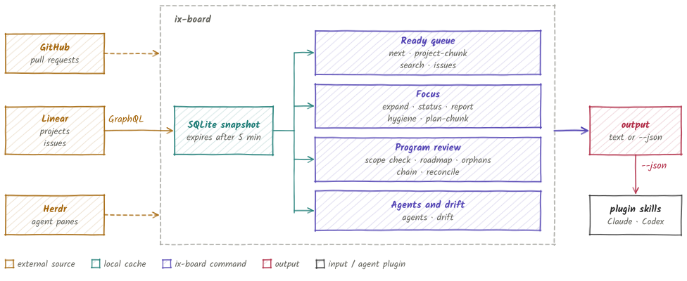
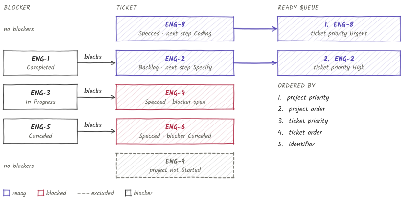
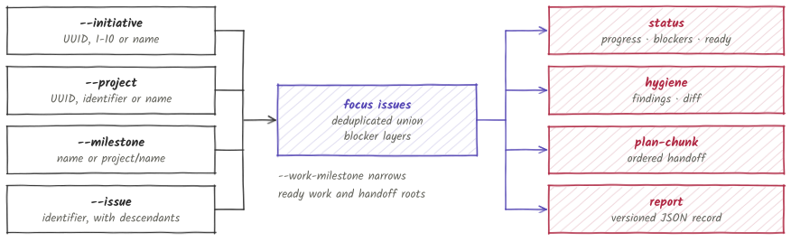

# ix-board

ix-board is a command-line tool that reads a Linear workspace and answers
planning questions from its structured data.

It reports the ready queue for a team, status and hygiene for a chosen focus,
and program reviews across initiatives, projects and GitHub pull requests. It
reads workflow states, priorities, orders and blocker relations, and treats
ticket descriptions and comments as data. Team leads and planners use the CLI
directly or through the ix-board plugin for Claude Code and Codex.

<picture>
  <source media="(prefers-color-scheme: dark)" srcset="docs/images/overview-dark.svg">
  
</picture>

> **Status: early alpha.** The commands, their output and the JSON schemas are
> still changing. Expect breaking changes.

## Install

Install the CLI from source:

```bash
cargo +1.98.1 install --git https://github.com/agent-ix/ix-board --branch main --locked
```

Save a Linear API key in the operating system credential store:

```bash
ix-board auth login
ix-board auth status
```

`LINEAR_API_KEY` overrides the saved key. For scripts, pipe the key to
`ix-board auth login --stdin`. Commands that read GitHub need `GITHUB_TOKEN`,
`GH_TOKEN` or the `gh` CLI. [Setup](docs/setup.md) lists which command uses which.

Install the plugin from the Agent IX marketplace. In Claude Code:

```text
/plugin marketplace add agent-ix/agent-plugins
/plugin install ix-board@agent-ix
```

In Codex:

```bash
codex plugin marketplace add agent-ix/agent-plugins
codex plugin add ix-board@agent-ix
```

Start a new agent session so the skills load. If a command fails or a skill is
missing, see the [setup guide](docs/setup.md).

## Usage

Each command group has one example here. [docs/cli-reference.md](docs/cli-reference.md)
lists every command and flag.

```bash
ix-board next --team ENG                       # ready queue for a team
ix-board project-chunk "Project name"          # goal, milestones, open tickets, blocker layers
ix-board search "dependency graph"             # search projects and issues
ix-board issues ENG-12 ENG-13                  # exact states for several issues
ix-board focus status --initiative "Initiative name"
ix-board focus hygiene --project "Project name"
ix-board focus plan-chunk --project "Project name" --size 5
ix-board scope check --scope program.toml
ix-board roadmap --scope program.toml
ix-board reconcile "Project name" --scope program.toml
ix-board agents "Team name"
ix-board drift --config drift-config.json --evidence drift-evidence.json
```

Add `--json` to any command for machine-readable output. The option goes before
or after the subcommand.

## Ready queue

`ix-board next --team <KEY>` lists the tickets a team can start next, in order,
with the reason for each position.

<picture>
  <source media="(prefers-color-scheme: dark)" srcset="docs/images/ready-queue-dark.svg">
  
</picture>

A ticket is ready when all of these hold:

- Its project has status `Started`. Tickets in `Paused` projects are excluded.
- Its state is `Backlog` or `Specify` (next step Specify) or `Specced` (next
  step Coding). Tickets in Coding or Review are not listed.
- Every ticket in its recursive `blocked-by` chain is `Completed`, including
  tickets from other teams. A canceled blocker stays unresolved.

[How it works](docs/how-it-works.md) describes the rules and the cache.

## Focus

A focus is a set of initiatives, projects, milestones and issues selected on the
command line. The selectors form a union, and each report reads the resulting
issue set and its blocker layers.

<picture>
  <source media="(prefers-color-scheme: dark)" srcset="docs/images/focus-dark.svg">
  
</picture>

| Command | Output |
| --- | --- |
| `focus status` | Progress by project and milestone, blockers, and ready issues |
| `focus hygiene` | Missing scope, overdue milestones, pull request mismatches, stale issues, near-duplicate titles, and changes since the last report |
| `focus plan-chunk` | Open issues in dependency order with readiness and acceptance criteria |
| `focus report` | A versioned JSON record for other clients |
| `focus expand` | The resolved issues and blocker layers |

See [focus](docs/focus.md) for the selector grammar and report contents.

## Program review

Program review commands take a TOML scope file that lists a program's
initiatives, projects, repositories and lanes. The file holds names only; counts come from live data.

| Command | Question |
| --- | --- |
| `scope check` | Do the listed initiatives, projects and repositories exist, and which projects are unplaced? |
| `roadmap` | What is each project's progress and last activity? |
| `orphans` | Which open and completed tickets have no project? |
| `chain` | What blocks this ticket or program, across teams? |
| `reconcile` | Where do a project's tickets disagree with its pull requests and branches? |

See [program review](docs/program-review.md) for the file format.

## Agents and drift

`agents` reports whether each agent in a team's Herdr workspaces is working,
waiting, asking, idle or at a prompt. `drift` evaluates lead activity against
configured thresholds from a versioned evidence file or live Linear data. See
[agents and drift](docs/agents-and-drift.md).

## Project controls

Two commands write to Linear. They change a project's status or priority and
nothing else.

```bash
ix-board project set-status "ENG-P1" Paused
ix-board project set-priority "ENG-P1" 2
```

Priority values are `0` no priority, `1` urgent, `2` high, `3` medium and `4`
low.

## Plugin skills

| Skill | Use |
| --- | --- |
| `ix-board-planning` | Ready queues, project context, blockers and program review |
| `focus-status` | Progress, blockers and ready work for a focus |
| `focus-hygiene` | Findings and changes since the last report |
| `plan-chunk` | An ordered handoff for the next lead |
| `ix-board-alpha-feedback` | Recording verified bugs and gaps |

## Documentation

- [How it works](docs/how-it-works.md)
- [Focus](docs/focus.md)
- [Program review](docs/program-review.md)
- [Agents and drift](docs/agents-and-drift.md)
- [CLI reference](docs/cli-reference.md)
- [Setup and troubleshooting](docs/setup.md)

## Contributing

See [CONTRIBUTING.md](CONTRIBUTING.md). Every contribution requires a signed
[CLA](CLA.md). Run `make ci` before opening a pull request.

## License

AGPL-3.0-or-later
